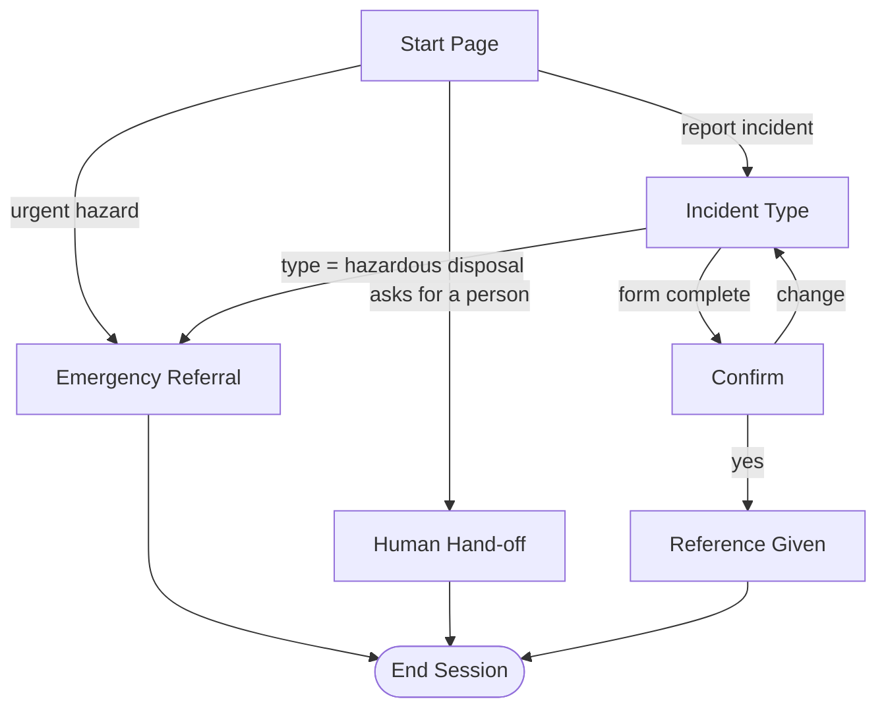

# Riverbend Green Incident Reporter (Q1)

A Dialogflow CX (Conversational Agents) prototype that lets staff, contractors and visitors of the fictional **Riverbend Corporate Campus** report sustainability and facilities incidents: water leaks, contaminated recycling, energy waste in empty rooms, unsafe disposal and blocked accessible paths.

- **Platform:** Google Conversational Agents (Dialogflow CX), flow-based agent
- **Agent location:** `australia-southeast1` (Sydney), shown in [evidence/03](03-agent-settings-location.png)
- **Data collected:** incident type and building only. The bot asks for no names, staff IDs or contact details.
- **Status:** working prototype. Escalation and logging are simulated (see Limitations).

## What the bot does

1. Greets the user and lists what it can report.
2. Collects the **incident type** and the **building** (required parameters).
3. If the type is *hazardous disposal*, it **branches** to an emergency referral (call 000 or the on-site emergency number) and ends. It does not file a normal report.
4. Otherwise it reads back a summary and asks the user to confirm or change it.
5. On confirmation it gives a closing message and ends.
6. At any point the user can ask for a person, which routes to a **human hand-off** page.

## Conversation flow

The screenshot of the built flow is [evidence/01-flow-map-final.png](01-flow-map-final.png).

## Contents

| Path | What it holds |
|---|---|
| [`conversation-design.md`](conversation-design.md) | Pages, routes, messages and the reasoning behind them |
| [`intents-and-entities.md`](intents-and-entities.md) | Intents, entity types, parameters |
| [`governance-and-accessibility.md`](governance-and-accessibility.md) | Privacy, human oversight, accessibility, limitations |
| [`test-log.md`](test-log.md) | Every test run, the faults found and how each was fixed |
| [`T3-execution-log-raw.txt`](T3-execution-log-raw.txt) | Raw Dialogflow execution log for the urgent-branch test |
| the `.png` files in this repository | Screenshots, numbered in build order (`01`-`12` build, `20`s tests, `30`s faults found) |

## Limitations

- **Escalation is simulated.** No ticket is created and nobody is contacted. In a real deployment the Confirm step would call a webhook that creates a ticket in the facilities help desk queue.
- **No reference number is generated.** The closing message does not issue one.
- **One issue per report.** A message containing two issues is treated as one report.
- **Single-letter building answers** ("B") were not recognised during testing. Synonyms such as "lab" resolve to Building B.
- **No privacy notice** is shown at the start of the conversation. The bot avoids personal data by not asking for any, but a notice would be added before real use.
